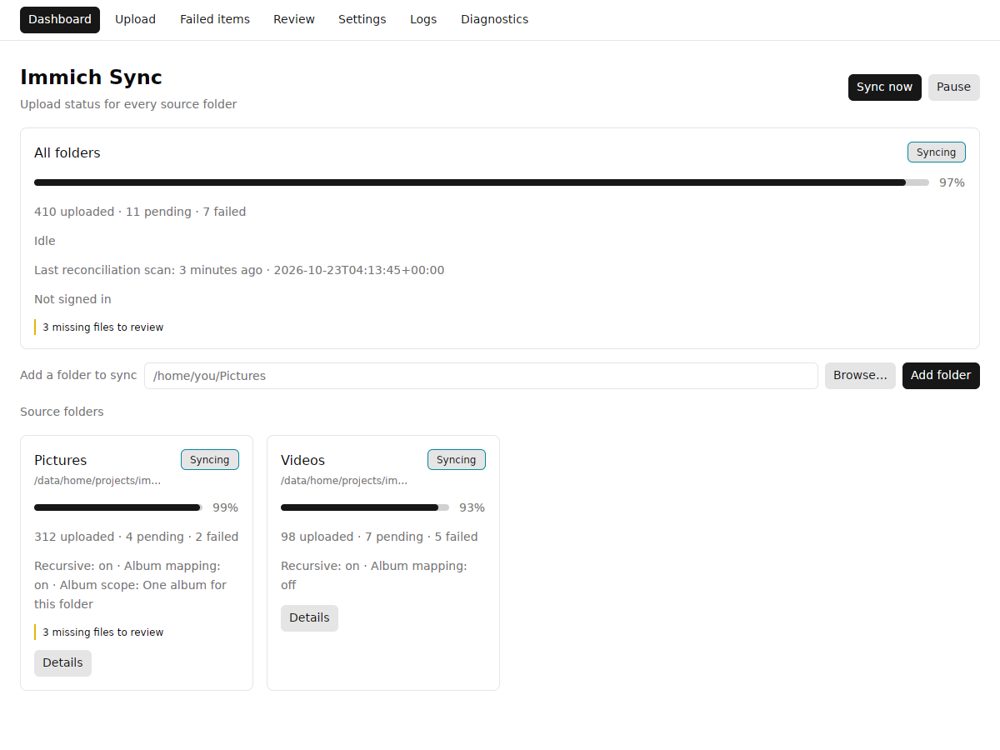

# Immich Sync

Keep folders on your computer in sync with your [Immich](https://immich.app/)
server. Upload only: it never deletes server-side assets on its own, and a local
file that disappears waits in a review list until you decide what happens to the
server copy.

[](https://github.com/elementalvoid/immich-sync/actions/workflows/ci.yml)
[](#license)



## What it does

- **Watches the folders you add** and uploads new and changed files as they
  happen, with a reconciliation scan at startup and every 30 minutes so nothing
  is missed.
- **Upload only.** It never deletes or changes an asset on the server by itself.
  A tracked local file that disappears appears in **Review**, where you choose
  **Keep** or **Trash**; a rename is recognised by content and is not a
  deletion.
- **Albums.** Put a folder's uploads into an album: one album per leaf folder,
  or one album for the whole folder.
- **Limits and retries.** Bandwidth and concurrency limits, backoff with a
  per-file attempt cap, and a **Failed items** view with **Retry**.
- **A tray that keeps working when the window is closed.** Its tooltip shows the
  activity, connection state, review count, upload progress, and the last error;
  its menu has Show, Pause, Resume, Sync now, and Quit.
- **Built for support.** Logs, a Diagnostics view, and a one-click **Collect
  bundle** archive that gathers the logs, versions, database health,
  configuration, and sizing into a single `.zip`.
- **Private by design.** Credentials live in the operating system's credential
  store (Windows Credential Manager, Secret Service on Linux), never in the
  settings file or the log. There is no telemetry: the client talks only to the
  Immich server you enter.

## Status

v1 targets Windows 10/11 (x64) and Linux desktops and is developed against
Immich v3.3.x. macOS is not part of v1.

> **No packaged release is published yet.** The first release will appear on the
> [releases page](https://github.com/elementalvoid/immich-sync/releases). Until
> then, build from source — see
> [Building from source](CONTRIBUTING.md#building-from-source). Windows builds
> are unsigned for now, so SmartScreen warns on first launch.

## Install

Requirements: Windows 10/11 (x64), or a Linux desktop with a Vulkan-capable
driver, and an Immich server reachable over HTTPS.

When a release is published, download the packages from the
[releases page](https://github.com/elementalvoid/immich-sync/releases). Each
release carries, for version `<version>`:

| File | Platform |
| --- | --- |
| `immich-sync_<version>_x64-setup.exe` | Windows 10/11 (x64) installer |
| `immich-sync_<version>_amd64.deb` | Debian/Ubuntu-family Linux |
| `immich-sync_<version>_x86_64.AppImage` | Any Linux desktop |
| `SHA256SUMS` | Checksums for all three packages |

### Windows 10/11

1. Run `immich-sync_<version>_x64-setup.exe`.
2. Windows SmartScreen shows "Windows protected your PC" because the installer
   is not code-signed. Click **More info**, then **Run anyway**. Code signing is
   planned for the public release; until then this warning is expected and is
   not a sign the download was altered. The checksums below are how you check
   that.
3. The installer asks who to install for. **All users** is preselected on a
   first install and installs to `C:\Program Files\Immich Sync`, with its
   uninstall entry in `HKLM` and shortcuts in the All Users Start Menu and on
   the public desktop. **Current user only** installs to
   `%LOCALAPPDATA%\Programs\Immich Sync`, with the entry in `HKCU` and
   shortcuts for that account alone. A reinstall or upgrade preselects the mode
   the previous install used.
4. The installer prompts for administrator elevation in **either** mode: it is
   built in a mode that always requests elevation, including for a current-user
   install. Declining the prompt cancels the install. It can start the app when
   it finishes.

Settings, state, logs, and the autostart entry are always per user, whichever
mode you pick; the install directory holds only the program.

Uninstall from **Settings → Apps → Immich Sync**. That removes the installed
copy and its shortcuts. Settings, state, and logs (see
[Where everything lives](#where-everything-lives)) are kept; delete those
folders yourself for a complete reset.

### Linux (deb)

```sh
sudo apt install ./immich-sync_<version>_amd64.deb
```

`apt` pulls in the runtime libraries the package declares. Start the app from
your desktop's application grid or run `immich-sync`. The package installs
`/usr/bin/immich-sync`, a desktop entry, and the app icon.

Remove it with `sudo apt remove immich-sync`.

### Linux (AppImage)

```sh
chmod +x immich-sync_<version>_x86_64.AppImage
./immich-sync_<version>_x86_64.AppImage
```

The AppImage needs FUSE 2 to mount itself (`libfuse2t64` on Ubuntu 24.04). On a
system without FUSE, run it extracted instead:

```sh
./immich-sync_<version>_x86_64.AppImage --appimage-extract-and-run
```

The desktop needs a Vulkan-capable driver for the window; a desktop install
already has one.

## Verify the download

`SHA256SUMS` lists the SHA-256 of every package in the release. Put it in the
same directory as the downloaded packages.

Linux:

```sh
sha256sum -c SHA256SUMS
```

Windows PowerShell:

```powershell
Get-FileHash .\immich-sync_<version>_x64-setup.exe -Algorithm SHA256
```

Compare the printed hash with the line for that file in `SHA256SUMS`.

Release packages are built by this repository's release workflow, which also
publishes a build provenance attestation once enabled. The process, and the
`gh attestation verify` check, are documented in
[CONTRIBUTING.md](CONTRIBUTING.md#releases).

## First run

On first launch the window opens on the **Dashboard**.

### Sign in

1. Open the **Settings** tab, under **Connection**.
2. Enter the server URL (for example `https://immich.example.com`), the email
   address of the Immich account, and either the password or an API key.
   Certificate verification stays on; a self-hosted server behind a private CA
   needs that CA in the operating system's certificate store.
3. Click **Sign in**.

The credential is stored in the operating system's credential store — Windows
Credential Manager, or the Secret Service (GNOME Keyring or KWallet) on Linux.
It is never written to the settings file or to the log. Later launches sign in
again from that stored credential, without asking. A wrong password shows an
error in the window and does not crash the client; the connection shows as
"Needs attention" in the window and the tray tooltip.

If the server has password login disabled, choose **API key** instead and paste
a key from Immich's account settings.

### Add folders

1. On the **Dashboard**, type or paste a folder path into **Add a folder to
   sync**, or click **Browse…** and pick it. Enter, **Browse…**, and **Add
   folder** all open **Folder setup**; none of them adds the folder yet.
2. **Folder setup** shows the path and four choices: **Recursive** (on by
   default), **Album mapping** (off by default), **Album scope** (**One album
   per folder**, one album per leaf folder, by default; or **One album for
   this folder**), and **Album title** (blank means the album takes the
   folder's name).
3. **Add** records the path and all four choices in one write, and the folder's
   status card appears on the **Dashboard**; **Cancel** writes nothing. Clicking
   the new card, or its **Details** control, opens **Folder detail**.
4. **Remove**, on a folder card or in **Folder detail**, stops syncing that
   folder; the detail asks for confirmation first. Nothing is deleted from the
   server: the folder's uploaded assets stay there.

Hidden files and folders, symlinks, temporary/partial files, and system files
are skipped by design. A source folder that is unplugged shows as unavailable on
its card instead of producing one error per file.

## Using the app

- **Tray.** The tray icon is fixed; its tooltip shows the activity (idle,
  syncing, paused, or needs attention), the connection state, the review count,
  upload progress, and the last error. The tray menu has
  **Show**, **Pause**, **Resume**, **Sync now**, and **Quit**.
- **Window.** Closing the window hides it; the client keeps running in the tray.
  **Quit** exits the client. Starting the app again focuses the running
  instance instead of starting a second one.
- **Views.** *Dashboard* (status and folders), *Upload* (send one file now to
  test the pipeline; type the path or click **Browse…**), *Failed items* (files
  the client gave up on, with **Retry**), *Review* (see below), *Settings*,
  *Logs*, *Diagnostics*. **Failed items** and **Review** each have a folder
  filter: **All folders**, or one source folder with a clearable chip.
- **Deletion review.** A tracked local file that disappears appears in
  **Review**; nothing changes on the server until you choose **Keep** or
  **Trash** for it. A rename is recognized by content and is not a deletion.
- **Settings.** Changes save immediately. General holds **Autostart at login**
  (off by default); Limits holds the bandwidth limit (0 means unlimited) and
  concurrent uploads; Sync holds the reconciliation scan interval and the retry
  attempt cap; Tagging holds **Tag uploaded assets** (on by default), which adds
  the fixed tag `immich-sync` to every asset the client uploads. With an API
  key, tagging needs the `tag.create`, `tag.asset`, and `asset.update`
  permissions. The same section shows the backfill's progress and **Tag existing
  assets now**, which tags every asset the client has already uploaded, and
  **View in Immich** (with a server URL set) opens the tag's page. Immich hides
  tags until **Tags** is enabled in your Immich account features (Account
  Settings → Features).
- **Diagnostics.** Client and server versions and permissions, the state
  database and its integrity, the last error per class, throughput, a
  **Collect bundle** action, and a **Rebuild** action that starts the state over
  and rescans every folder.
- **Logs.** The tail of the log file, selectable for copying, the level control,
  and a **Copy all** control that copies every line shown. The tail follows the
  newest file while the view is open; scrolling up pauses it and shows the new
  line count with **Jump to latest**, and **Refresh** re-reads the tail once.
  The log never contains the password, API key, or session token.
- The theme follows the system theme.

## Where everything lives

All paths are per user. `%APPDATA%` and `%LOCALAPPDATA%` are the usual Windows
roaming and local application-data directories; the Linux paths follow the XDG
base directories (`~/.config`, `~/.local/share`).

| What | Windows | Linux |
| --- | --- | --- |
| Settings (`settings.toml`) | `%APPDATA%\immich-sync\` | `~/.config/immich-sync/` |
| State database (`state.db`) and logs | `%LOCALAPPDATA%\immich-sync\` | `~/.local/share/immich-sync/` |
| Autostart entry (when enabled) | `HKCU\Software\Microsoft\Windows\CurrentVersion\Run` | `~/.config/autostart/immich-sync.desktop` |

The log file is `immich-sync.log.<date>`, one file per day, five kept. The state
database stays on this machine by design: never put it on a network share or in
a cloud-sync folder. The **Settings** view's *Storage* card shows the resolved
paths.

## Privacy and security

- **Credentials** are stored in the operating system's credential store and are
  never written to the settings file or the log.
- **No telemetry.** The only network traffic is to the Immich server you enter.
- **Redacted logs.** The log pipeline redacts passwords, API keys, session
  tokens, and URL userinfo. The **Collect bundle** archive re-serialises the
  settings and leaves out server-supplied failure text, so no credential reaches
  it.
- **Upload only.** Nothing is deleted or modified on the server without your
  explicit **Keep** or **Trash** decision in Review.
- **Local state stays local.** The SQLite database is never uploaded anywhere.

## Troubleshooting

### "Windows protected your PC" when installing (SmartScreen)

Expected: v1 Windows binaries are unsigned. Click **More info → Run anyway**.
Verify the download with `SHA256SUMS` first if the warning worries you. Signing
arrives with the public release.

### The app seems to do nothing after launch

It starts in the tray. Double-click the tray icon, or start the app again to
bring the window to the front. If there is no tray icon, see the Linux note
below; the window is still running.

### No tray icon on Linux (GNOME)

GNOME does not show StatusNotifierItem icons without an AppIndicator extension.
Install one such as "AppIndicator and KStatusNotifierItem Support" and restart
the session. Without a tray the client still runs, but because there is no
**Quit** menu item, closing the window exits the client.

### Sign-in fails with a credential-store message (Linux)

The password and API key are stored in the Secret Service, so a Secret Service
provider (GNOME Keyring, KWallet) must be running and unlocked. Install or start
one, then sign in again; the client retries the credential store on every
sign-in.

### The AppImage will not start

Install FUSE 2 (`libfuse2t64` on Ubuntu 24.04) or run the file with
`--appimage-extract-and-run`.

### Sync does not pick up a new file

Hidden files, symlinks, temporary files, and system files are skipped by
design, and a file inside a folder that is not added is not tracked. Check the
folder card and **Diagnostics**; if the watcher missed a change, the next
reconciliation scan (30 minutes by default) finds it, or click **Sync now** in
the tray.

### A file keeps failing

Open **Failed items**: the reason is listed per file. Fix the cause (for
example an unsupported format or a missing server permission) and click
**Retry**.

### The settings file was damaged

A settings file that cannot be parsed is left in place, the defaults are used,
and the Settings view shows what happened. Fix or delete the file and change a
setting to write a fresh one.

### Logs for a bug report

Open the **Logs** view or read the file listed in
[Where everything lives](#where-everything-lives). Raise the level to `Debug`
while reproducing a problem, then set it back. Credentials are redacted, so the
log is safe to attach.

### Collect a debug bundle

The **Diagnostics** view's **Collect bundle** action writes one `.zip` and shows
its full path; **Copy path** puts that path on the clipboard, so it can be pasted
into a message or a file manager. Collection runs in the background, so the
window stays usable.

The archive is saved as `immich-sync-debug-<date>-<time>.zip` in your Downloads
folder (your home folder when there is none). It holds:

- the newest three log files, with the last 256 KiB of each, so a full log
  rotation is not included;
- the client version, the operating system and architecture, the Immich server
  version, and the schema version;
- the state database's schema version, size, per-table row counts, `quick_check`
  verdict, and the last error of each failure class;
- the settings values as a `settings.toml` (only the settings the client knows,
  so a line pasted into the file by hand is left out), plus the source folders
  with their album mapping and scope;
- the library's tracked bytes, item counts by state, and the folder, review,
  dead-letter, and version counts;
- the connection state, the engine's activity, and the upload rate.

It holds no password, API key, or session token: the settings file never stores
them, and the log pipeline redacts them. It does hold your folder paths, your
account email, the server URL, and the log files, so review the archive before
attaching it to a message. A recorded failure message is left out (only its
class is included), because its text can come from the server.

A collection that cannot read the logs, the state database, or the server still
writes an archive; the view and the archive's `README.txt` both list what was
missing.

## Contributing

Issues and pull requests are welcome. See [CONTRIBUTING.md](CONTRIBUTING.md) for
the development setup, the gates, the screenshot recipe, and the release
process. Report security problems privately, as described in
[SECURITY.md](SECURITY.md).

## License

Licensed under either of the [Apache License, Version 2.0](LICENSE-APACHE) or the
[MIT license](LICENSE-MIT), at your option. Unless you explicitly state
otherwise, any contribution intentionally submitted for inclusion in this
project shall be dual-licensed as above, without any additional terms or
conditions.
